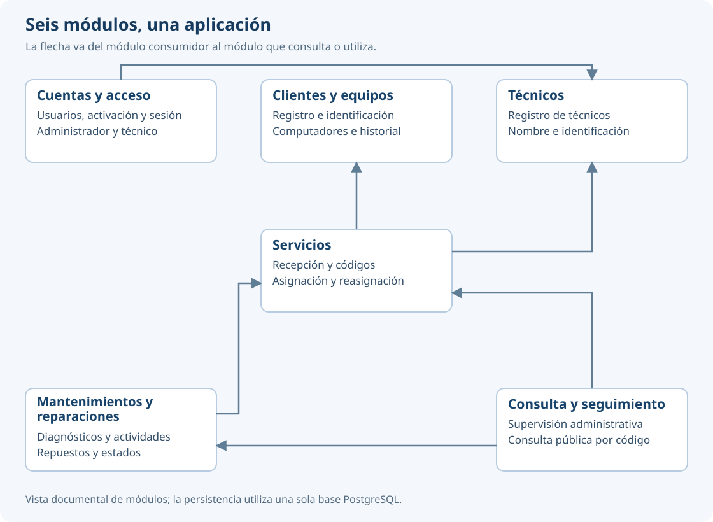

# Arquitectura y patrones

Valtraza es un monolito modular con Laravel 12, PHP 8.3 y una sola base PostgreSQL. Nginx recibe la solicitud, `public/index.php` inicia Laravel y las rutas despachan al controlador de cada operación. Un módulo puede tener varios controladores. Blade presenta el resultado, los controladores coordinan la validación y los servicios, y Eloquent conserva los datos.

| Capa | Ubicación y función |
| --- | --- |
| Presentación | `resources/views`, componentes Blade y recursos de `public/assets` |
| Control | `routes`, `app/Http/Controllers`, middleware y Form Requests |
| Lógica de negocio | `app/Services`, `app/States`, observers y reglas de la operación |
| Acceso a datos | Modelos Eloquent de `app/Models` y consultas encapsuladas |
| Datos | PostgreSQL; esquema, restricciones e índices de `database` |

Las capas de lógica y acceso a datos forman el modelo de MVC. La autorización se exige en rutas y solicitudes; las operaciones sobre un servicio vuelven a comprobar al encargado dentro de la transacción.

| Módulo | Responsabilidad e interfaces utilizadas |
| --- | --- |
| Clientes y equipos | Clientes, computadores e historial; ofrece RegistroClientesEquipos |
| Técnicos | Registro de técnicos; ofrece RegistroTecnicos |
| Cuentas y acceso | Usuarios, activación y sesión; utiliza RegistroTecnicos |
| Servicios | Registro, códigos, asignación y pertenencia; utiliza Clientes y equipos y Técnicos |
| Mantenimientos y reparaciones | Diagnósticos, actividades, repuestos y cambio de estado; utiliza Servicios |
| Consulta y seguimiento | SupervisionServicios y ConsultaPublica agregan lecturas de Servicios y LecturaAvance |

Servicios no depende de Mantenimientos y reparaciones. La condición de completar con diagnóstico se resuelve en la operación de trabajo técnico, evitando una dependencia circular. La consulta pública obtiene el computador mediante la relación del servicio y construye una salida con campos permitidos. En supervisión, el controlador consulta también el listado de técnicos para el filtro. La ficha del cliente combina los datos del equipo con `HistorialEquipos` desde la capa de control.

| Patrón | Aplicación concreta |
| --- | --- |
| MVC | Separación de vistas, controladores y modelo |
| Controlador frontal | Entrada por `public/index.php` |
| Plantilla maestra | Layouts base, administrador, técnico y público |
| Cadena de filtros | Middleware de sesión, autenticación, rol, CSRF y cabeceras |
| Validación de formularios | Form Requests con reglas y mensajes en español |
| Active Record | Modelos Eloquent con sus claves y relaciones |
| Capa de servicios | RegistroClientesEquipos, GestionServicios, RegistroTrabajoTecnico y servicios de consulta |
| Observador | Generación de códigos y notificación de nuevos registros de avance |
| Estado | Clases Pendiente, EnCurso y Completado para aplicar el estado del servicio |

Los detalles del cambio de estado, el historial del computador y la asignación están en [Trabajo técnico](../uso/trabajo-tecnico.md). El [análisis de GitDiagram](analisis-gitdiagram.md) compara el grafo público regenerado con estas responsabilidades y contiene la vista de referencia por rol.

Los observers emiten `ServicioActualizado` al confirmar la transacción. La pantalla que guarda redirige al detalle y las demás vistas muestran el estado al volver a consultarse.

## Vista de módulos

La vista resume las dependencias principales entre módulos. La composición de supervisión y de la ficha del cliente se realiza en el controlador. El administrador y el técnico usan rutas autenticadas. El cliente consulta por código en una ruta pública.
