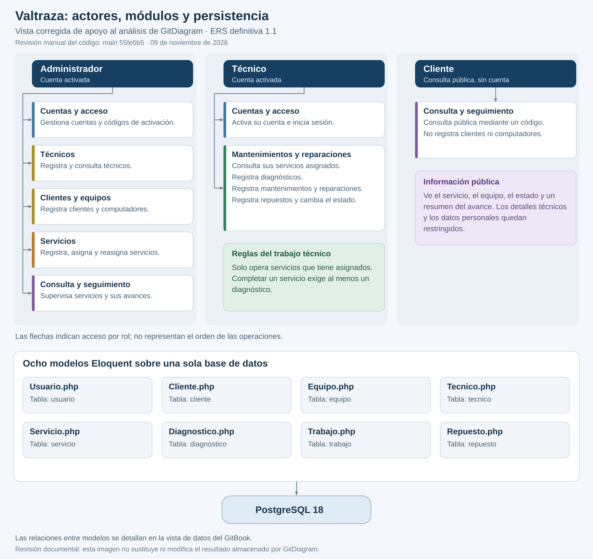
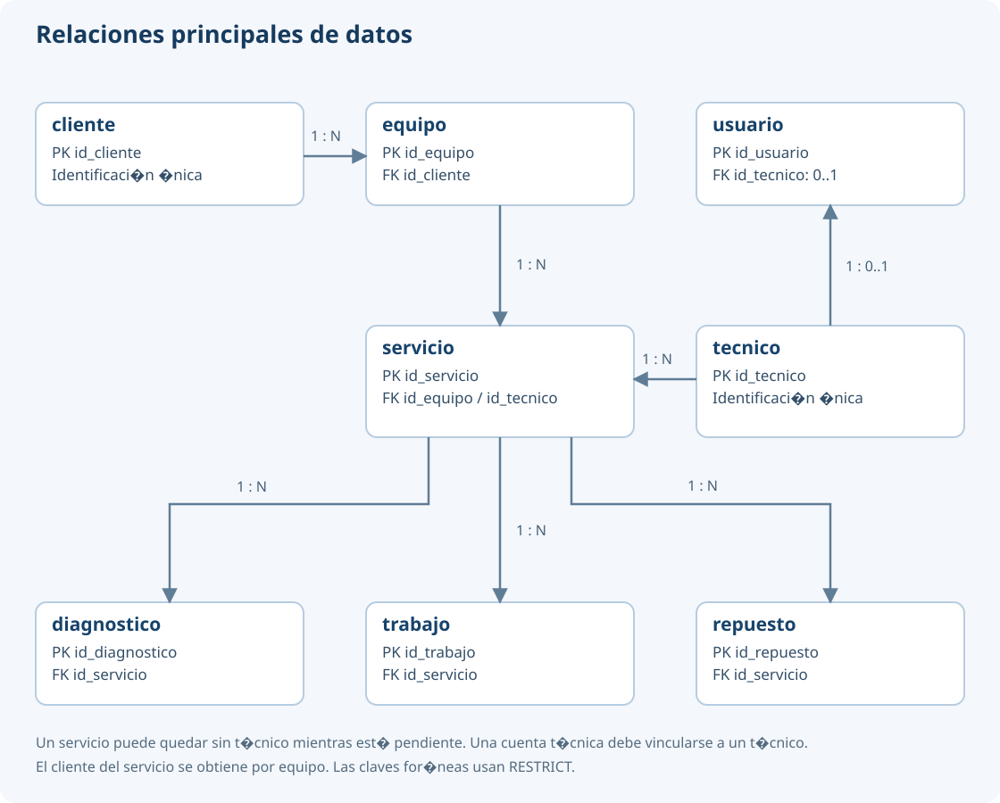

# Análisis de GitDiagram

## Enlace público y versión de referencia

**[Abrir el diagrama público de Valtraza en GitDiagram](https://gitdiagram.com/meneses1111/valtraza-valletech)**

El análisis corresponde al proyecto Valtraza del equipo ValleTech. Se contrasta la captura `diagram.png`, compartida por Johan el **09 de noviembre de 2026** después de indicar que regeneró el diagrama, con la ERS definitiva 1.1 y el código de la entrega en `main` **55fe5b5858397cca57444dcb8c786b6ad896d813**.

Ese SHA identifica el código utilizado para esta revisión manual. La captura no muestra el SHA que GitDiagram ingirió: no se atribuye al generador una versión exacta que no pueda comprobarse. El enlace público puede mostrar otro resultado si posteriormente se regenera.

Esta página reúne el **análisis y el enlace público** solicitados en la actividad. La vista corregida que se incluye más adelante es una elaboración manual contrastada con el código; no modifica el resultado almacenado en GitDiagram.

## Lectura del resultado generado

El resultado reconoce tres actores —administrador, técnico y cliente— y agrupa funcionalidades de acceso, recepción y asignación, trabajo técnico, consulta y supervisión. También relaciona servicios de aplicación, modelos y una base de datos común. Esta agrupación permite ubicar las responsabilidades generales del sistema, aunque no reproduce literalmente los seis módulos acordados.

La lectura es coherente con una aplicación Laravel organizada mediante MVC y capas: las rutas llegan a controladores, estos utilizan servicios de aplicación y los modelos Eloquent acceden a PostgreSQL. La separación entre consulta pública y supervisión también aparece en la imagen. Sin embargo, el grafo mezcla niveles de detalle y contiene asignaciones de responsabilidad que deben corregirse al explicarlo.

## Diferencias encontradas y corrección

| Elemento observado en la captura | Contraste con la implementación | Corrección documental |
| --- | --- | --- |
| El cliente tiene una flecha «inicia sesión» hacia Acceso. | El cliente no tiene cuenta. La consulta por código es pública, conforme a RF14. | Conectar al cliente únicamente con la consulta pública por código. El acceso autenticado corresponde al administrador y al técnico. |
| El cliente tiene una flecha «registra datos» hacia Registro de clientes. | Las rutas de registro de clientes y equipos exigen autenticación y rol administrador. | Atribuir esos registros al administrador. |
| El bloque de registros técnicos se representa con `Diagnostico.php`. | El servicio técnico conserva diagnósticos, trabajos y repuestos como modelos distintos, además del estado del servicio. | Explicitar `Diagnostico.php`, `Trabajo.php` y `Repuesto.php` y las operaciones sobre el estado. |
| El registro de técnicos aparece como una dependencia consultada por la gestión de servicios. | La selección de técnicos para asignar un servicio es distinta del registro de técnicos, reservado al administrador. | Mostrar al administrador como responsable del registro de técnicos y mantener la consulta de técnicos para la asignación. |

La omisión de una clase en un resumen visual no demuestra que falte su implementación. En este caso, `Trabajo.php` y `Repuesto.php` existen, y `Servicio` declara las relaciones `diagnosticos()`, `trabajos()` y `repuestos()`. Las flechas incorrectas de los actores tampoco representan los permisos efectivos: estos se controlan en rutas y servicios.

## Vista corregida de actores, módulos y persistencia

Descargas: [imagen PNG](../assets/arquitectura-revisada.png), [SVG ampliable](../assets/arquitectura-revisada.svg) y [fuente Mermaid de actores y módulos](../assets/actores-modulos.mmd).

Las flechas de esta vista indican qué actor utiliza cada módulo. No son una secuencia de ejecución ni relaciones entre tablas. Un mismo módulo puede aparecer en más de una columna porque sus operaciones se autorizan según el rol; supervisión administrativa y consulta pública forman parte del módulo Consulta y seguimiento.

## Correspondencia con los seis módulos

| Módulo acordado | Responsabilidad comprobada |
| --- | --- |
| Clientes y equipos | El administrador registra clientes y computadores y consulta su historial. |
| Técnicos | El administrador registra y consulta técnicos; sus datos se usan al crear cuentas y asignar servicios. |
| Cuentas y acceso | Activación e ingreso de administrador y técnico; creación de cuentas técnicas por el administrador. |
| Servicios | El administrador registra servicios, genera sus códigos, asigna o reasigna técnicos y consulta los servicios. |
| Mantenimientos y reparaciones | El técnico consulta sus servicios asignados y registra diagnósticos, actividades, repuestos y cambios de estado. |
| Consulta y seguimiento | El administrador supervisa los servicios; el cliente consulta el estado y un resumen permitido mediante el código de seguimiento. |

Las dependencias entre módulos se explican en la [arquitectura del sistema](README.md). Servicios utiliza Clientes y equipos y Técnicos; el trabajo técnico utiliza Servicios; la consulta reúne información de los servicios y de su avance. La regla de completar con diagnóstico se aplica en la operación de trabajo técnico.

## Modelo de datos completo

Los ocho modelos son `Usuario`, `Cliente`, `Equipo`, `Tecnico`, `Servicio`, `Diagnostico`, `Trabajo` y `Repuesto`. Cada servicio corresponde a un equipo; el cliente se obtiene a través de ese equipo. El servicio puede estar sin técnico mientras permanece pendiente, y reúne sus diagnósticos, trabajos y repuestos. La cuenta de un técnico se vincula con su registro de técnico; el administrador no utiliza esa vinculación.

La consulta pública presenta el servicio, el computador, el estado y un resumen del avance. No entrega al cliente los datos personales ni el detalle de diagnósticos, trabajos y repuestos. El [modelo de datos](../base-de-datos/modelo.md) contiene las claves, restricciones y reglas de persistencia.

## Fuentes comprobadas

Las siguientes referencias quedan fijadas al código utilizado para la revisión:

- [Consulta pública sin autenticación](https://github.com/meneses1111/Valtraza-Valletech/blob/55fe5b5858397cca57444dcb8c786b6ad896d813/routes/modulos/consulta-publica.php).
- [Clientes y equipos: rutas del administrador](https://github.com/meneses1111/Valtraza-Valletech/blob/55fe5b5858397cca57444dcb8c786b6ad896d813/routes/modulos/clientes-equipos.php).
- [Técnicos: rutas del administrador](https://github.com/meneses1111/Valtraza-Valletech/blob/55fe5b5858397cca57444dcb8c786b6ad896d813/routes/modulos/tecnicos.php).
- [Trabajo técnico: rutas de diagnósticos, trabajos, repuestos y estado](https://github.com/meneses1111/Valtraza-Valletech/blob/55fe5b5858397cca57444dcb8c786b6ad896d813/routes/modulos/trabajo-tecnico.php).
- [Modelo Servicio y sus relaciones](https://github.com/meneses1111/Valtraza-Valletech/blob/55fe5b5858397cca57444dcb8c786b6ad896d813/app/Models/Servicio.php).
- [Operaciones sobre servicios asignados y comprobación de diagnóstico](https://github.com/meneses1111/Valtraza-Valletech/blob/55fe5b5858397cca57444dcb8c786b6ad896d813/app/Services/TrabajoTecnico/RegistroTrabajoTecnico.php).
- [Campos permitidos en la consulta pública](https://github.com/meneses1111/Valtraza-Valletech/blob/55fe5b5858397cca57444dcb8c786b6ad896d813/app/Services/Consulta/ConsultaPublica.php).

## Conclusión

GitDiagram ayuda a reconocer las áreas del repositorio y sus relaciones generales. La revisión detectó errores de atribución al cliente y una representación incompleta de los registros técnicos. La vista corregida y las referencias al código aclaran esas diferencias sin cambiar la aplicación ni presentar la salida automática como una especificación exacta. La comprobación de requisitos y la aceptación del sistema se sustentan en la [matriz y las evidencias de pruebas](../pruebas/estado-y-evidencias.md), no en la apariencia del grafo.
