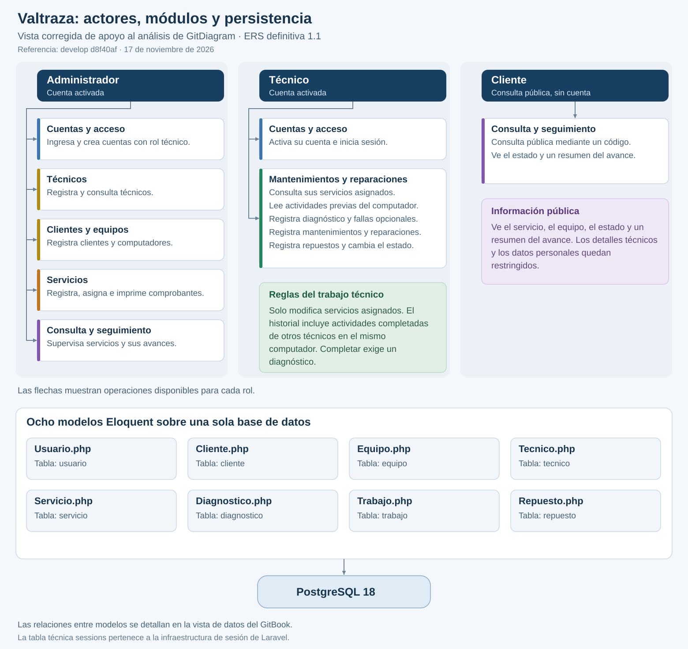

# Análisis de GitDiagram

## Diagrama público regenerado

[Diagrama interactivo](https://gitdiagram.com/meneses1111/valtraza-valletech) · [Exportación Markdown del generador](https://gitdiagram.com/meneses1111/valtraza-valletech.md)

Se regeneró y comprobó el grafo público el **17 de noviembre de 2026**. GitDiagram enlaza al código de `main` y la salida no indica el commit exacto que leyó. La revisión documental de esta página se contrastó con la ERS 1.1 y `develop` `d8f40af`.

El grafo regenerado ubica el inicio de sesión en administrador y técnico, y la consulta pública por código en el cliente. Carga la cuenta desde `Usuario` y distingue `Diagnostico`, `Trabajo` y `Repuesto`. Estas diferencias respecto de las capturas anteriores quedan corregidas en el generador.

## Diferencias que conserva el grafo automático

| Lo que muestra GitDiagram | Cómo funciona Valtraza |
| --- | --- |
| Agrupa recepción, asignación y registro de técnicos. | El diseño distingue **Clientes y equipos**, **Técnicos** y **Servicios**. El administrador registra a los técnicos, y Servicios consulta ese registro para asignar un encargado. |
| Atribuye la creación de cuentas al registro de técnicos. | `CuentasController` coordina la operación y `Acceso` crea una cuenta con rol fijo de técnico. `RegistroTecnicos` se ocupa del registro de personas. |
| Atribuye el historial del equipo al controlador de registro de servicios. | La ficha administrativa utiliza `FichaClienteController` y `HistorialEquipos`. Desde un servicio asignado, el técnico puede leer actividades anteriores completadas del mismo computador, incluso de otro técnico. El acceso directo a un servicio ajeno sigue restringido. |
| Resume el trabajo técnico y la consulta pública. | Trabajo técnico aplica la regla de completar con diagnóstico. Consulta pública usa `GestionServicios` y `LecturaAvance`; obtiene el computador por el servicio y presenta un resumen sin detalles técnicos ni datos personales. |

## Vista de referencia del GitBook

[Descargar PNG](../assets/arquitectura-revisada.png) · [Abrir SVG](../assets/arquitectura-revisada.svg) · [Fuente Mermaid](../assets/actores-modulos.mmd)

| Módulo | Responsabilidad |
| --- | --- |
| Clientes y equipos | Registro de clientes y computadores, y consulta de la ficha e historial desde administración. |
| Técnicos | Registro administrativo de técnicos, consultado para asignaciones y cuentas. |
| Cuentas y acceso | Ingreso y activación, creación de cuentas de técnicos por el administrador. |
| Servicios | Registro, códigos, asignación, reasignación y comprobante. |
| Mantenimientos y reparaciones | Servicios asignados, historial de actividades completadas del computador en solo lectura, diagnósticos, trabajos, repuestos y estado. |
| Consulta y seguimiento | Supervisión administrativa y consulta del cliente por código sin cuenta. |

El [diagrama de módulos y dependencias](README.md) muestra el monolito Laravel 12 y PHP 8.3. El diagrama de actores representa el acceso por rol. Los ocho modelos de negocio persisten en PostgreSQL. `sessions` es una tabla técnica de Laravel. Consulta el [modelo de datos](../base-de-datos/modelo.md) para ver claves y relaciones.

## Fuentes de código y pruebas

- [Creación de cuentas](https://github.com/meneses1111/Valtraza-Valletech/blob/d8f40afb652931628c5b775c1fbe8fc9826213e5/app/Http/Controllers/CuentasController.php) y [servicio de acceso](https://github.com/meneses1111/Valtraza-Valletech/blob/d8f40afb652931628c5b775c1fbe8fc9826213e5/app/Services/Cuentas/Acceso.php).
- [Registro de técnicos](https://github.com/meneses1111/Valtraza-Valletech/blob/d8f40afb652931628c5b775c1fbe8fc9826213e5/app/Services/Tecnicos/RegistroTecnicos.php), [registro y asignación](https://github.com/meneses1111/Valtraza-Valletech/blob/d8f40afb652931628c5b775c1fbe8fc9826213e5/app/Http/Controllers/Servicios/ServiciosController.php) y [ficha administrativa del cliente](https://github.com/meneses1111/Valtraza-Valletech/blob/d8f40afb652931628c5b775c1fbe8fc9826213e5/app/Http/Controllers/Servicios/FichaClienteController.php).
- [Asignación, autorización e historial](https://github.com/meneses1111/Valtraza-Valletech/blob/d8f40afb652931628c5b775c1fbe8fc9826213e5/app/Services/Servicios/GestionServicios.php) y [reglas de trabajo técnico](https://github.com/meneses1111/Valtraza-Valletech/blob/d8f40afb652931628c5b775c1fbe8fc9826213e5/app/Services/TrabajoTecnico/RegistroTrabajoTecnico.php).
- [Ruta pública](https://github.com/meneses1111/Valtraza-Valletech/blob/d8f40afb652931628c5b775c1fbe8fc9826213e5/routes/modulos/consulta-publica.php) y [campos permitidos](https://github.com/meneses1111/Valtraza-Valletech/blob/d8f40afb652931628c5b775c1fbe8fc9826213e5/app/Services/Consulta/ConsultaPublica.php).
- [Pruebas y evidencias por versión](../pruebas/estado-y-evidencias.md).
