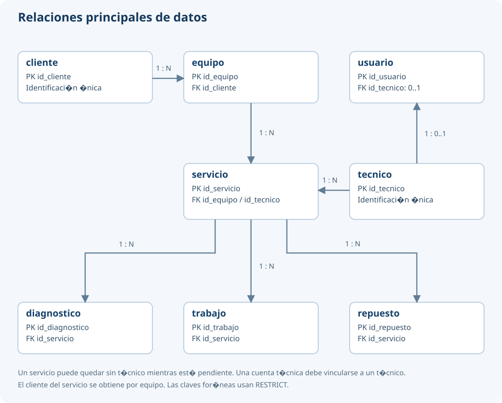

# Base de datos

PostgreSQL guarda ocho tablas: cliente, tecnico, usuario, equipo, servicio, diagnostico, trabajo y repuesto. El cliente de un servicio se obtiene mediante su equipo.

El esquema utiliza tres tipos ENUM: rol_usuario (administrador, tecnico), estado_servicio (pendiente, en_curso, completado) y tipo_trabajo (mantenimiento, reparacion). La migración lee database/sql/esquema_valtraza.sql. Los modelos conservan las claves propias del diseño y no utilizan created_at ni updated_at.

Después de configurar una base vacía llamada valtraza, se ejecuta `php artisan migrate` y después `php artisan db:seed`. El seeder crea admin sin activar y muestra su código de activación en consola.

| Tabla | Clave y datos principales |
| --- | --- |
| cliente | id_cliente; nombre, numero_identificacion único, correo opcional |
| tecnico | id_tecnico; nombre, numero_identificacion único, correo opcional |
| usuario | id_usuario; nombre_usuario único, contrasena_hash, sal, rol, codigo_activacion único, activado, id_tecnico opcional y único |
| equipo | id_equipo; codigo_equipo único, id_cliente, fecha_registro, modelo y otros_datos_tecnicos opcionales |
| servicio | id_servicio; codigo_servicio y codigo_seguimiento únicos, id_equipo, id_tecnico opcional, fecha, nombre, descripcion_problema y estado |
| diagnostico | id_diagnostico; id_servicio, resultado, fallas_identificadas, pruebas_realizadas, observaciones y fecha_registro |
| trabajo | id_trabajo; id_servicio, tipo, descripcion, observaciones y fecha_registro |
| repuesto | id_repuesto; id_servicio, nombre, cantidad positiva, observacion y fecha_registro |

Las claves primarias son enteros de identidad. Un cliente tiene varios equipos; cada equipo puede tener varios servicios. Cada servicio tiene cero o un técnico y varios diagnósticos, trabajos y repuestos. Las siete claves foráneas usan RESTRICT. La relación usuario-técnico es obligatoria para el rol técnico y no se permite para administrador. Un servicio sin técnico solo puede estar pendiente.

El archivo SQL versionado contiene los tipos, longitudes, nulabilidad y restricciones completas. La segunda migración incorpora ocho índices operativos: equipo por cliente; servicio por equipo; diagnóstico, trabajo y repuesto por servicio; servicio por técnico/estado/fecha y por estado/fecha; y el índice parcial de servicios sin técnico. Su creación usa IF NOT EXISTS para admitir índices previamente existentes; el rollback de esa migración retira los índices con esos nombres, incluso si ya existían. No hacer rollback en una base compartida sin revisar su efecto y tener copia.

Las comprobaciones automáticas utilizan una base separada llamada valtraza_test. RefreshDatabase elimina también los tipos ENUM antes de volver a migrar. EsquemaTest comprueba los valores permitidos y el rechazo de valores desconocidos. Nunca debe ejecutarse esa suite sobre una base con información que se necesite conservar. Los casos, la matriz y los ciclos del responsable de pruebas se realizan por separado.
