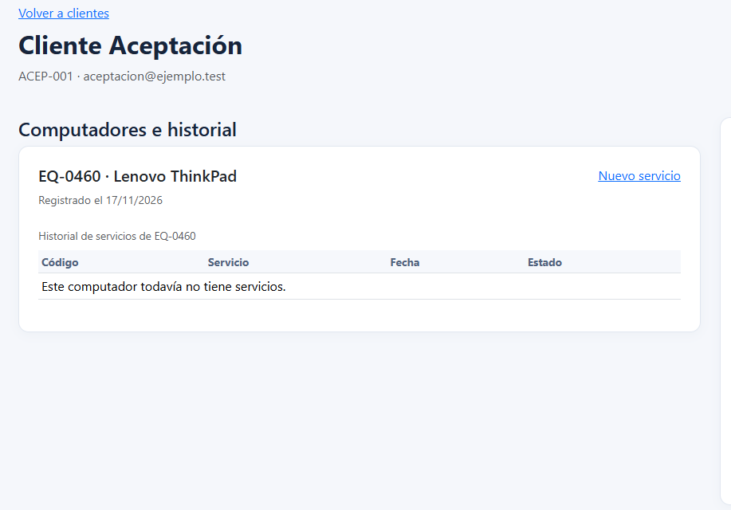
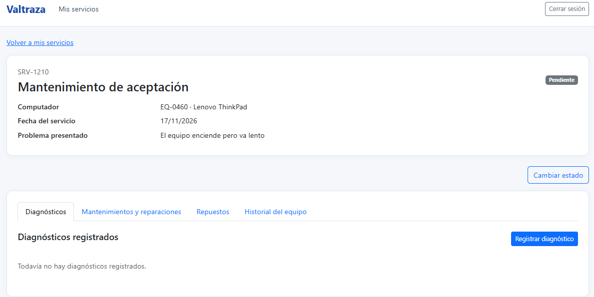
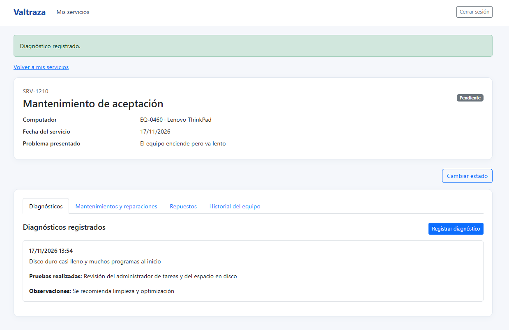
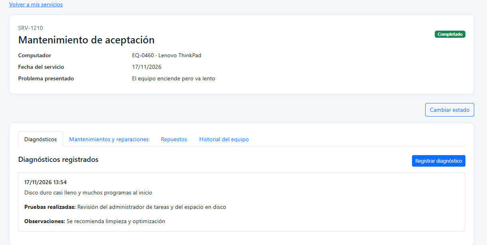
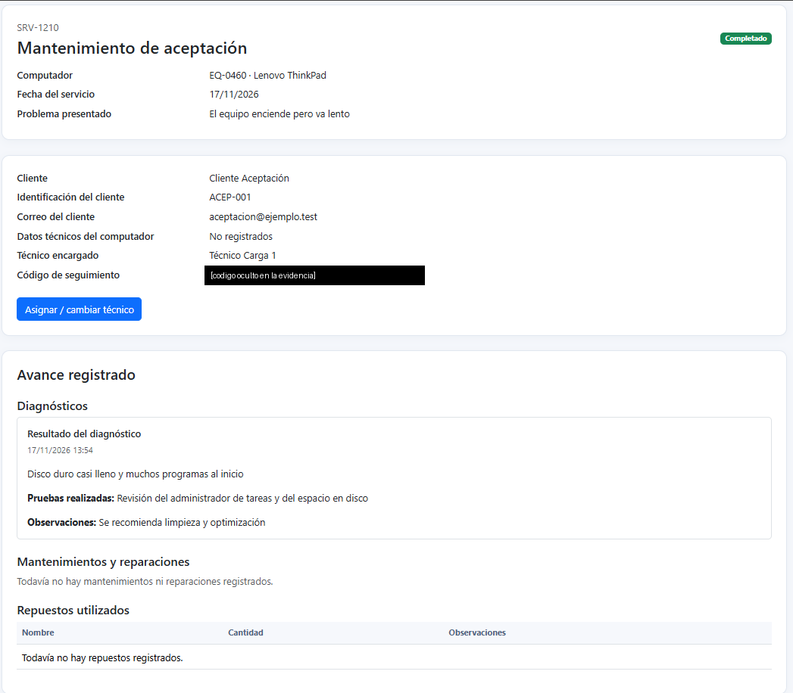
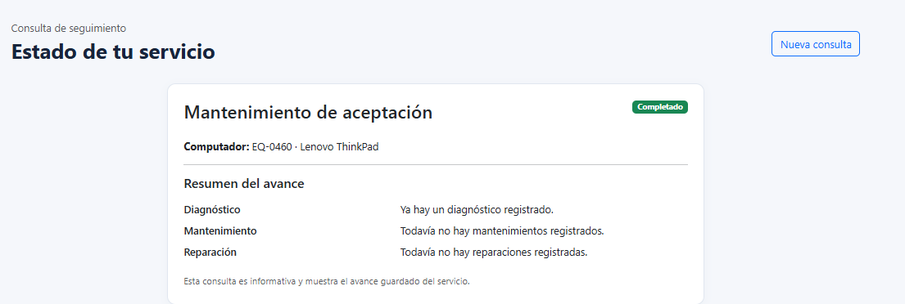

# Manual de usuario de Valtraza

Equipo ValleTech · Administración de la Información · Universidad Santiago de Cali

Versión 1.0 · 18 de noviembre de 2026 · Alcance funcional ERS 1.1

Este manual permite registrar y seguir la atención de un computador en Valtraza. Está dirigido al administrador que organiza los servicios, al técnico que registra el trabajo y al cliente que consulta su estado. Cada procedimiento indica desde dónde empezar, qué hacer y cómo reconocer el resultado.

## Contenido

1. Prepararse para usar Valtraza
2. Reconocer la interfaz y los permisos
3. Activar la cuenta e ingresar
4. Registrar técnicos y crear sus cuentas
5. Registrar clientes y computadores
6. Registrar un servicio y entregar su código
7. Asignar o cambiar el técnico
8. Consultar los servicios asignados y el historial
9. Registrar un diagnóstico
10. Registrar mantenimientos y reparaciones
11. Registrar repuestos
12. Cambiar el estado del servicio
13. Supervisar desde administración
14. Consultar el estado como cliente
15. Resolver dificultades y cerrar la sesión
16. Guía rápida y términos

## Prepararse para usar Valtraza

Valtraza organiza la recepción del computador, la asignación del encargado, el diagnóstico, las actividades realizadas y la consulta del estado. El servicio puede estar Pendiente, En curso o Completado.

Antes de empezar, dispón de un computador con Google Chrome o Mozilla Firefox actualizado y de la dirección HTTPS que te entregue el responsable de la instalación. La aplicación y su base de datos deben estar encendidas y ser accesibles desde tu red. Las resoluciones de referencia son 1366 × 768 y 1920 × 1080.

El administrador y el técnico necesitan una cuenta activada. El cliente solo necesita el código de seguimiento de su servicio. La dirección del GitBook abre la documentación; para usar Valtraza debes abrir la dirección de la aplicación que corresponda a tu instalación.

El manual cubre las funciones RF01–RF14. La instalación del servidor, las copias de seguridad y el soporte técnico se explican en el capítulo Instalación y operación del GitBook. Las capturas ilustran un recorrido con datos de prueba del ciclo 3; los nombres y consecutivos de tu instalación serán distintos.

Documentos relacionados: ERS definitiva 1.1; diseño de sistema, software y datos del proyecto; documentación de uso por rol; matriz y evidencias del ciclo 3. Estos documentos se reúnen desde el GitBook público de Valtraza.

## Reconocer la interfaz y los permisos

El menú cambia según la cuenta. Desde el panel administrativo se accede a Técnicos, Cuentas, Clientes y Servicios. El técnico utiliza Mis servicios. La página de inicio contiene la consulta por código para el cliente.

Los campos marcados con asterisco son obligatorios. Los mensajes próximos al campo indican qué debes corregir. Al guardar correctamente aparece una confirmación o el detalle actualizado. Comprueba ese resultado antes de repetir una operación. En los listados, utiliza los filtros y los controles de página para localizar otros registros.

| Persona | Puede realizar |
| --- | --- |
| Administrador | Registrar técnicos, crear cuentas de técnicos, registrar clientes y computadores, registrar servicios, asignar o cambiar técnico y supervisar el avance. |
| Técnico | Consultar y actualizar sus servicios asignados, registrar diagnósticos, actividades y repuestos, cambiar el estado y leer el historial relacionado del computador. |
| Cliente | Consultar el estado y el resumen general del servicio mediante el código, sin registrarse. |

El administrador consulta los avances técnicos; el registro de diagnósticos, actividades y repuestos corresponde al técnico encargado. El cliente no puede ver datos personales ni resultados técnicos detallados.

## Activar la cuenta e ingresar

Antes de empezar: recibe tu nombre de usuario y tu código de activación por el canal que acuerdes con el administrador. La primera cuenta administrativa la prepara el responsable de instalar el sistema.

1. Abre la dirección de Valtraza y entra a la opción de activación, disponible también en la guía de la pantalla de ingreso.
2. Introduce el código de activación, define una contraseña de al menos ocho caracteres y completa su confirmación.
3. Envía el formulario y comprueba la confirmación de activación. El código es de un solo uso.
4. Abre Ingresar y escribe tu nombre de usuario y contraseña. Administrador y técnico usan el mismo formulario.
5. Pulsa Ingresar. El sistema abre el panel correspondiente a tu rol.

Si la contraseña es muy larga, el formulario puede rechazarla: el límite de almacenamiento equivale a 72 bytes y algunos caracteres ocupan más de uno. Elige otra que cumpla el mínimo y sea aceptada por el formulario.

Si el código ya fue utilizado, no repitas la activación: ingresa con la contraseña definida. Ante un código desconocido o un problema con la cuenta, solicita ayuda al administrador. Nunca publiques tu contraseña ni el código de activación.

## Registrar técnicos y crear sus cuentas

Antes de empezar: ingresa como administrador. Registrar al técnico y crear su cuenta son dos operaciones distintas.

1. Abre Técnicos desde el menú del panel.
2. Escribe el nombre y la identificación del técnico. El correo electrónico es opcional.
3. Envía el formulario y verifica que aparezca en el listado. Si la identificación está repetida, revisa el registro existente.
4. Abre Cuentas. En Crear cuenta de técnico, selecciona la persona que acabas de registrar.
5. Escribe un nombre de usuario disponible y pulsa Crear cuenta. Cada técnico puede tener una sola cuenta.
6. Entrega al técnico el nombre de usuario y el código mostrado en la confirmación. Pídele que active su cuenta y defina su propia contraseña.

Resultado esperado: el técnico figura en Técnicos y su cuenta aparece en Cuentas, primero pendiente de activar y después activa. La lista de cuentas no muestra el código de activación; conserva la información de la confirmación únicamente para entregarla a la persona correspondiente.

Si no hay técnicos disponibles en el selector, registra primero al técnico o comprueba si ya tiene cuenta. Esta pantalla crea cuentas con permisos de técnico.

## Registrar clientes y computadores

Antes de empezar: ingresa como administrador y reúne la información del cliente y del computador recibido.

1. Abre Clientes y escribe el nombre y la identificación del cliente. El correo es opcional.
2. Envía el formulario. Si la identificación ya existe, utiliza el enlace a su ficha en lugar de crear un duplicado.
3. Abre la ficha del cliente y localiza el formulario para registrar un computador.
4. Indica la fecha de registro. Añade el modelo y los demás datos técnicos cuando estén disponibles; esos datos son opcionales.
5. Guarda y verifica que el computador aparezca en la ficha, con un código generado por el sistema, por ejemplo EQ-0001.
6. Para otro computador del mismo cliente, repite el registro desde esa ficha.

Resultado esperado: la ficha reúne los computadores del cliente y el historial de servicios de cada uno. Cada nuevo servicio se vincula al computador correcto. El cliente registrado aquí no recibe una cuenta de acceso.

## Registrar un servicio y entregar su código

Antes de empezar: el cliente y su computador deben estar registrados. Ingresa como administrador.

1. Abre Servicios y la opción Nuevo servicio. También puedes iniciar un servicio desde el computador en la ficha del cliente.
2. Selecciona al cliente y pulsa Ver computadores.
3. Selecciona el computador recibido. Si aún no existe, abre la ficha del cliente y regístralo.
4. Completa la fecha, el nombre del servicio y la descripción del problema presentado.
5. Envía el formulario y comprueba la confirmación de registro.
6. Usa Copiar código para entregar el código de seguimiento al cliente. Si necesitas una constancia, pulsa Imprimir comprobante y utiliza el diálogo de impresión del navegador.

Resultado esperado: el servicio tiene un código consecutivo, por ejemplo SRV-0001, y queda Pendiente y sin técnico asignado. El código de seguimiento es un valor distinto del consecutivo del servicio y del código del computador. El cliente necesita el código de seguimiento completo para consultar.

Entrega ese código únicamente al cliente correspondiente. Comprueba el computador seleccionado antes de guardar; el sistema valida que pertenezca al cliente.

## Asignar o cambiar el técnico

Antes de empezar: el servicio y el técnico deben estar registrados. Para que el técnico trabaje en la aplicación, su cuenta debe estar creada y activada.

1. Como administrador, abre Servicios y localiza el servicio. Puedes filtrar Sin técnico asignado.
2. Abre el detalle y pulsa Asignar o cambiar técnico.
3. Selecciona al encargado y pulsa Guardar asignación.
4. Comprueba que el detalle muestre el técnico elegido.
5. Si necesitas reasignar, repite el procedimiento con el nuevo encargado.

Resultado esperado: el servicio aparece en Mis servicios del técnico seleccionado. Un técnico puede recibir varios servicios. Reasignar conserva el estado, los diagnósticos, los trabajos y los repuestos ya registrados; el técnico anterior deja de tener acceso operativo a ese servicio.

Si el selector no contiene técnicos, regístralos desde Técnicos. Si la operación informa que el registro está ocupado o no confirma el cambio, vuelve a consultar el detalle antes de intentarlo de nuevo.

## Consultar los servicios asignados y el historial

Antes de empezar: activa tu cuenta e ingresa como técnico. El administrador debe haberte asignado al menos un servicio.

1. Abre Mis servicios. La lista presenta primero los servicios más recientes.
2. Si necesitas reducir los resultados, elige Pendiente, En curso o Completado en el filtro de estado.
3. Abre el servicio y comprueba el computador, el problema presentado y el estado.
4. Utiliza las pestañas de Diagnósticos, Mantenimientos y reparaciones, Repuestos e Historial del equipo.
5. En el historial, consulta las actividades de servicios anteriores completados del mismo computador. Puedes leerlas aunque las haya realizado otro técnico.

Resultado esperado: encuentras los servicios que tienes asignados y el contexto necesario para atender el computador. El historial es de solo lectura y no autoriza abrir o modificar otros servicios ajenos.

Si no aparecen servicios, retira el filtro. Si la lista sigue vacía, consulta al administrador para confirmar la asignación. Los listados y secciones muestran quince registros por página; utiliza su paginación para ver el resto.

## Registrar un diagnóstico

Antes de empezar: ingresa como técnico y abre uno de tus servicios asignados.

1. En Diagnósticos, pulsa Registrar diagnóstico.
2. Escribe el resultado de la revisión. Si corresponde, marca No se encontraron fallas.
3. Cuando existan, describe las fallas identificadas en su campo opcional. Puedes añadir las pruebas realizadas y observaciones.
4. Revisa el contenido y pulsa Guardar diagnóstico.
5. Comprueba la confirmación y la aparición del registro en el detalle del servicio.

Resultado esperado: queda un diagnóstico asociado al servicio. Si marcaste No se encontraron fallas, se registra esa conclusión y no se guarda una descripción de fallas.

Revisa antes de guardar: la interfaz agrega diagnósticos al historial y no ofrece editarlos ni borrarlos. Si debes aclarar un registro anterior, acuerda con el responsable cómo dejar una nueva anotación identificable.

## Registrar mantenimientos y reparaciones

Antes de empezar: abre el detalle de un servicio que tengas asignado como técnico.

1. Entra en Mantenimientos y reparaciones y abre el formulario de registro de actividad.
2. Selecciona el tipo de actividad: Mantenimiento o Reparación.
3. Describe el trabajo realizado de forma concreta; por ejemplo, la limpieza del sistema de ventilación o el reemplazo de un componente defectuoso.
4. Revisa los datos y guarda la actividad.
5. Comprueba que se muestre en la lista con el tipo correcto.

Resultado esperado: el servicio conserva una nueva actividad de mantenimiento o reparación. Registra únicamente trabajos realmente realizados. Si un diagnóstico determina que no hace falta una reparación, no debes inventar una actividad para poder completar el servicio.

Los registros guardados no se editan ni se borran desde la interfaz. El historial anterior del computador sirve de referencia y permanece en solo lectura.

## Registrar repuestos

Antes de empezar: abre un servicio asignado y reúne los datos de los repuestos que efectivamente se utilizaron.

1. Entra en Repuestos y abre el formulario de registro.
2. Escribe el nombre del repuesto y una cantidad entera mayor que cero. Las observaciones son opcionales.
3. Si utilizaste otros repuestos, agrega las filas necesarias y completa cada una.
4. Retira cualquier fila que hayas añadido por error antes de guardar.
5. Envía el formulario y comprueba los repuestos y cantidades en el detalle.

Resultado esperado: cada repuesto utilizado queda asociado al servicio. Quitar una fila del formulario solo retira un dato todavía no guardado; no elimina registros del historial.

Valtraza registra el uso de repuestos en la atención. Esta función no administra existencias, compras, precios ni facturación.

## Cambiar el estado del servicio

Antes de empezar: ingresa como el técnico encargado y abre el servicio.

1. Pulsa Cambiar estado.
2. Elige Pendiente, En curso o Completado de acuerdo con la situación real.
3. Si vas a completar, confirma primero que exista al menos un diagnóstico registrado.
4. Guarda y comprueba el aviso y la etiqueta del estado actualizado.

Resultado esperado: el administrador puede consultar el nuevo estado y el cliente lo ve al realizar una nueva consulta con su código. No es obligatorio registrar una reparación ni repuestos para completar un servicio que no los necesitó.

Si intentas completar sin diagnóstico, el sistema impide el cambio. Registra el diagnóstico y vuelve a intentarlo. Si el servicio fue reasignado mientras lo atendías, deja de operar sobre él y consulta al administrador.

## Supervisar desde administración

Antes de empezar: ingresa como administrador y abre Servicios.

1. Combina los filtros de estado, técnico y asignación para localizar la atención que necesitas revisar.
2. Para pendientes de asignación, utiliza Sin técnico asignado. Pulsa Limpiar para retirar los filtros.
3. Abre Ver servicio.
4. Revisa los datos del cliente, del computador, del encargado y los diagnósticos, actividades y repuestos.
5. Si necesitas cambiar al encargado, utiliza la opción de asignación del servicio.

Resultado esperado: puedes consultar el avance completo y distinguir las secciones que todavía no tienen registros. La supervisión consulta los registros técnicos; no los edita ni los borra.

Si no hay resultados, retira filtros y revisa las otras páginas. Los filtros se conservan al avanzar en la paginación. Consulta nuevamente el detalle para ver los cambios recientes del técnico.

## Consultar el estado como cliente

Antes de empezar: ten a mano el código de seguimiento que te entregaron al registrar tu servicio. No necesitas cuenta ni contraseña.

1. Abre la página de inicio de la aplicación.
2. Escribe o pega el código de seguimiento completo, respetando mayúsculas y minúsculas.
3. Pulsa Consultar.
4. Revisa el nombre del servicio, el código y modelo del computador, el estado y las indicaciones generales sobre diagnóstico, mantenimiento o reparación.
5. Pulsa Nueva consulta para regresar al inicio.

Resultado esperado: obtienes el resumen del servicio correspondiente a ese código. No se muestran el nombre del cliente, sus datos de contacto, el técnico, el problema reportado, las descripciones de los diagnósticos, los repuestos ni otros servicios del computador.

Si el código no se encuentra, comprueba que sea el de seguimiento y que esté completo. Si lo perdiste, comunícate con el establecimiento que recibió el equipo. Si aparece un tiempo de espera por exceso de consultas, espera los segundos indicados antes de reintentar. La consulta admite diez solicitudes por minuto desde la misma dirección de red.

## Resolver dificultades y cerrar la sesión

| Situación | Qué hacer |
| --- | --- |
| Usuario o contraseña incorrectos | Revisa los datos y si la cuenta fue activada. El mismo mensaje puede aparecer por una cuenta inactiva. Usa la guía de activación o solicita ayuda al administrador. |
| No recuerdas la contraseña | Contacta al administrador o responsable de soporte. La aplicación no ofrece recuperación de contraseña por correo. |
| Campo incompleto o dato repetido | Lee el aviso junto al campo, corrige y vuelve a guardar. Las contraseñas y los códigos no se recuperan automáticamente al corregir formularios. |
| Acceso no autorizado | Comprueba tu rol y la asignación del servicio. No intentes acceder escribiendo otra dirección; solicita la revisión al administrador. |
| Sesión vencida o formulario expirado | Vuelve a ingresar o recarga el formulario. Consulta si el registro se guardó antes de repetir el envío. |
| Demasiados intentos | Espera el tiempo indicado en la pantalla y vuelve a intentar. |
| Página o servicio inexistente | Regresa al listado o al inicio y comprueba la dirección o el registro buscado. |
| Servicio temporalmente no disponible | Espera y vuelve a consultar. Si continúa, avisa al responsable del servidor. |
| El navegador no conecta | Revisa la dirección y la conexión; pide confirmar que el servidor y la base estén activos. |

Para salir, pulsa Cerrar sesión en el menú superior y comprueba que vuelvas a la pantalla pública o de ingreso. Cierra la sesión siempre que utilices un computador compartido.

Cuando solicites soporte, describe la pantalla, la tarea y el mensaje recibido. No envíes contraseñas, códigos de activación ni capturas con códigos de seguimiento visibles. El canal de atención lo define el establecimiento o el responsable de la instalación.

## Guía rápida y términos

| Opción o término | Significado |
| --- | --- |
| Ingresar | Acceder con una cuenta de administrador o técnico activada. |
| Crear cuenta | Generar una cuenta de técnico para una persona previamente registrada. |
| Ver computadores | Mostrar los computadores del cliente seleccionado al registrar un servicio. |
| Copiar código | Copiar el código de seguimiento que se entrega al cliente. |
| Imprimir comprobante | Abrir la impresión de la constancia de registro del servicio. |
| Guardar asignación | Confirmar el técnico encargado del servicio. |
| Mis servicios | Listado de atenciones asignadas al técnico autenticado. |
| Cambiar estado | Guardar Pendiente, En curso o Completado. |
| Limpiar | Retirar filtros de la lista de servicios. |
| Nueva consulta | Volver al formulario público de seguimiento. |
| Diagnóstico | Conclusión de la revisión del computador, haya o no fallas. |
| Actividad | Trabajo guardado como mantenimiento o reparación. |
| Código de seguimiento | Valor que permite al cliente consultar un servicio; debe mantenerse reservado. |
| Historial del equipo | Atenciones anteriores del mismo computador; el técnico lee las actividades completadas relacionadas. |

Documentación pública: https://meneses1111.github.io/Valtraza-Valletech/
